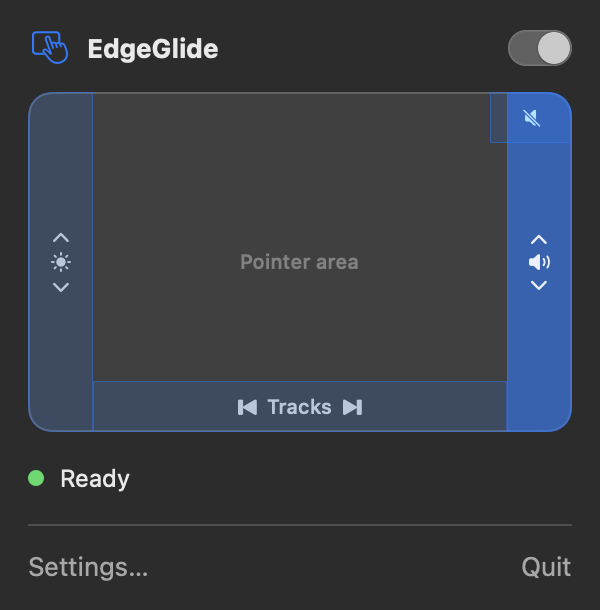
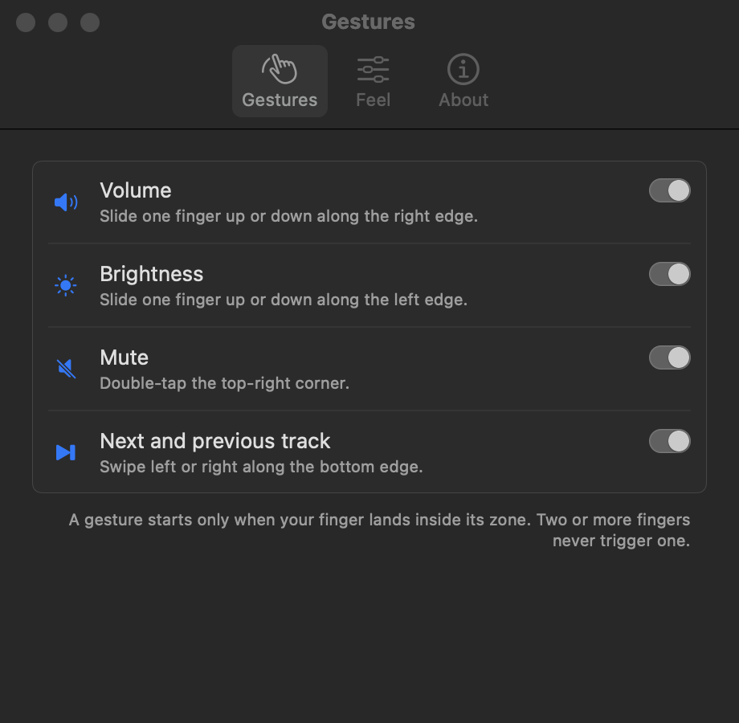

# EdgeGlide

EdgeGlide is a free macOS menu bar app that turns the edges of your trackpad
into volume, brightness, mute, and track controls.



## Gestures

| Where on the trackpad | What it does |
|-----------------------|--------------|
| Slide one finger up or down the right edge | Changes the volume |
| Slide one finger up or down the left edge | Changes the built-in display brightness |
| Double-tap the top-right corner | Mutes or unmutes |
| Swipe one finger left or right along the bottom edge | Plays the previous or next track |

## Run it locally

1. Check that you have macOS 14 or later, a Mac with a trackpad, and Xcode or
   the Command Line Tools (`xcode-select --install`).
2. Clone the repository:

   ```sh
   git clone https://github.com/nosyminotaur/edgeglide.git
   cd edgeglide
   ```

3. Build the app: `scripts/build-app.sh`
4. Start the app: `open build/EdgeGlide.app`

For first launch, Settings, permissions, and troubleshooting, see the
[getting-started guide](docs/getting-started.md).

## More details



### Features

- A gesture starts only when your finger lands inside an edge zone. Touches
  that start in the middle, and any touch with two or more fingers, are
  ignored, so pointing, scrolling, and system gestures keep working.
- Each step plays a haptic tick on the trackpad. You choose the strength.
- The menu bar panel shows a drawing of your trackpad. Each zone lights up
  when its gesture fires, and turned-off gestures appear dimmed.
- The panel shows one status line: **Ready**, or the most important problem
  with a button that fixes it.

### Install from a release

1. Download `EdgeGlide-<version>.zip` from the
   [releases page](https://github.com/nosyminotaur/edgeglide/releases).
2. Open the zip, and move `EdgeGlide.app` to `/Applications`.
3. Start the app for the first time. The app is signed ad hoc, not notarized,
   so macOS blocks a normal double-click. Use one of these:
   - In Finder, right-click `EdgeGlide.app`, choose **Open**, then choose
     **Open** again.
   - In Terminal, remove the quarantine flag, then open the app:

     ```sh
     xattr -dr com.apple.quarantine /Applications/EdgeGlide.app
     open /Applications/EdgeGlide.app
     ```

EdgeGlide has no Dock icon. Look for the trackpad-and-hand icon in the menu
bar.

### Build from source

You need macOS 14 or later and a Swift 6 toolchain. The Command Line Tools
are enough; you don't need Xcode. The steps are in
[Run it locally](#run-it-locally).

- To run the unit tests, run `swift test`.
- `scripts/build-app.sh` writes `build/EdgeGlide.app` and signs it ad hoc.
- To build a versioned release zip, run `scripts/release.sh 0.1.0`. The
  script stamps the version into the bundle before signing, writes
  `build/EdgeGlide-0.1.0.zip`, and prints its SHA-256 checksum. Without a
  version argument, it uses the version in `Resources/Info.plist`.

#### Update the screenshots

To redraw the screenshots in `docs/`, run:

```sh
swift build -c release
.build/release/EdgeGlide --render-screenshots docs
```

The `--render-screenshots` flag is for development only. The app draws the
panel in an offscreen window, opens its real Settings window to draw each
tab, writes the PNG files, and quits.

### Permissions

EdgeGlide needs one permission, and only for a fallback:

- **Accessibility** lets EdgeGlide post media keys. It needs this only when
  the private MediaRemote framework can't send next and previous track
  commands. To grant it, choose **Allow media keys** in the panel, or add
  EdgeGlide in **System Settings > Privacy & Security > Accessibility**.

Trackpad input, volume, mute, brightness, and haptics need no permission.

Each rebuild changes the ad hoc signature, so macOS may treat the new build as
a different app. You might need to grant Accessibility again.

### How it works

- **Touches and haptics** come from the private MultitouchSupport framework.
  EdgeGlide reads raw contacts and plays ticks through the trackpad actuator.
- **Volume and mute** use public CoreAudio APIs on the default output device.
- **Brightness** uses the private DisplayServices framework on the built-in
  display.
- **Track control** uses the private MediaRemote framework, with media keys as
  the fallback.

EdgeGlide loads each private framework at run time with `dlopen`. When a
symbol is missing, that one feature stops and the panel shows the problem;
the rest of the app keeps working.

The App Store doesn't accept apps that use private frameworks, and these
frameworks don't work in the App Sandbox. That's why EdgeGlide ships as a
download. Apple can change these frameworks in any macOS update.

To see the logs, run:

```sh
log show --last 5m --info --predicate 'subsystem == "com.edgeglide.app"'
```

### Known limits

- The pointer still moves while you slide along an edge. EdgeGlide reads
  touches but doesn't block them.
- Launch at login may not turn on unless `EdgeGlide.app` is in
  `/Applications`.
- Brightness works only on the built-in display.
- Some outputs, such as many HDMI and USB devices, have no software volume
  control.
- A trackpad that connects after launch needs **Rescan trackpads** in
  **Settings > About**. EdgeGlide rescans by itself after sleep.

### License

EdgeGlide is available under the MIT License. See [the license file](LICENSE).
